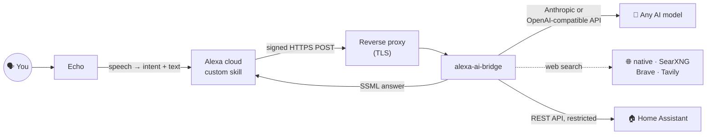

<p align="center"></p>

<p align="center">
  
  
  
  
  
</p>

<p align="center">
  <a href="#quick-start"><b>Quick start</b></a> ·
  <a href="docs/providers.md">Models &amp; providers</a> ·
  <a href="docs/architecture.md">Architecture</a> ·
  <a href="docs/setup.md">Setup guide</a> ·
  <a href="docs/home-assistant.md">Home Assistant</a> ·
  <a href="docs/security.md">Security</a> ·
  <a href="docs/lessons-learned.md">Lessons learned</a>
</p>

---

**Alexa AI Bridge** turns any Echo into a voice for **the AI model of your choice**: Claude, GPT, Gemini, Mistral,
DeepSeek, Grok, Llama or Qwen. Use a cloud API or run a model locally with Ollama.

It is a small self-hosted web service plus an Alexa custom skill. You get real back-and-forth conversations, not
canned commands. The assistant remembers what you said, searches the web when a question needs fresh data, and
can read and control your home through Home Assistant within strict limits that the service enforces.

> 🗣️ *"Alexa, apri cervellone."* — 🔊 *"Dimmi pure."*<br>
> 🗣️ *"Che tempo fa domani?"* — 🔊 *"Domani sole al mattino, nuvole dal pomeriggio e massima di 21 gradi."*<br>
> 🗣️ *"Accendi la luce dello stanzino."* — 🔊 *"Fatto."* — 🗣️ *"Spegnila."* — 🔊 *"Spenta."*

The skill in this repository speaks **Italian** (`it-IT`), but nothing in the design depends on the language: every
spoken string and every sample utterance lives in two files you can translate.

## Demo

These are real conversations in the Alexa developer console simulator, which sends the same requests as an Echo:

| Free questions | Follow-ups with memory | A longer session |
|:---:|:---:|:---:|
|  |  |  |

| Live web search | Home control, with confirmation and hard limits |
|:---:|:---:|
|  |  |

<sub>The last two were re-rendered from the real answers of the end-to-end test, with personal details removed.</sub>

## Features

- 🤖 **Any model, any provider**: the Anthropic Messages API and the OpenAI-compatible Chat Completions API
  between them cover OpenAI, Gemini, Mistral, Groq, DeepSeek, xAI, OpenRouter, Ollama, LM Studio, vLLM and
  LiteLLM. Switching model means changing three lines in `.env`.
- 🗣️ **Free-form conversation**: ask anything. Follow-ups like *"and what if I don't have parmesan?"* keep the
  context.
- ⏱️ **No more "the skill took too long"**:
  - answers that need more than Alexa's ~8 seconds keep running in the background;
  - meanwhile Alexa says *"I'm thinking, ask me in a moment"*;
  - you hear the answer when you say *"so?"*, or when you reopen the skill.
- 🌐 **Live web search for every model**:
  - Claude uses Anthropic's native search;
  - every other model can use your own free **SearXNG** (one command, included), **Brave** or **Tavily**.
- 🏠 **Home Assistant tools**: *"how's the house?"*, *"turn on the storage-room light"*, *"turn it off"*,
  *"close every shutter"* (asks first), *"open the front door"* (always refused).
- 🔒 **Secure by default**:
  - every request from Amazon is verified: signature, certificate chain, timestamp and skill ID;
  - locks, alarms, scripts and technical services can never be controlled;
  - multi-room actions need a spoken *yes*, and the **service** checks it, not the model.
- 🛟 **Degrades gracefully**: if a model has no tool support, rejects a parameter or returns its reasoning in
  `<think>` tags, the service adapts on its own.
- 🧪 **Tested**:
  - 54 tests against fake model endpoints (both formats), a fake Home Assistant and fake search backends;
  - an end-to-end script for your real setup.

## Pick your model

| | `LLM_API` | `LLM_BASE_URL` | Web search |
|---|---|---|---|
| **Anthropic Claude** | `anthropic` | `https://api.anthropic.com/v1` | native |
| **OpenAI** | `openai` | `https://api.openai.com/v1` | SearXNG / Brave / Tavily |
| **Google Gemini** | `openai` | `https://generativelanguage.googleapis.com/v1beta/openai` | SearXNG / Brave / Tavily |
| **Mistral · Groq · DeepSeek · xAI** | `openai` | the provider's `/v1` URL | SearXNG / Brave / Tavily |
| **OpenRouter** (hundreds of models) | `openai` | `https://openrouter.ai/api/v1` | SearXNG / Brave / Tavily, or `:online` |
| **Ollama · LM Studio** (local, free) | `openai` | `http://host.docker.internal:11434/v1` | SearXNG |

Copy-paste presets, model tips and reasoning settings are in **[docs/providers.md](docs/providers.md)**.

## How it works



1. Alexa turns your speech into an intent. Alexa only captures free text in an `AMAZON.SearchQuery` slot when the
   sentence starts with one of the skill's ~150 *carrier phrases* (*che*, *come*, *accendi*, …). A custom slot
   handles short phrases (*spegnila*, *di più*, *a metà*).
2. The service:
   - verifies the request;
   - adds the voice instructions and today's date;
   - calls the model with up to four tools: web search plus three for the home.
3. If the model answers within `ATTESA_MAX` seconds, Alexa speaks the answer straight away. Otherwise the service
   keeps it for 15 minutes and delivers it on *"allora?"* (*so?*), on *"sì"*, or when you reopen the skill.

Full details: [docs/architecture.md](docs/architecture.md).

## Quick start

> You need a free Amazon developer account, a host with Docker and a public HTTPS name, an AI model (any API key,
> or Ollama), and optionally Home Assistant.

```bash
git clone https://github.com/<you>/alexa-ai-bridge.git && cd alexa-ai-bridge
cp .env.example .env && chmod 600 .env     # SKILL_ID, one model block, optional WEB_* and HA_*
docker compose up -d --build               # add  --profile searxng  for free web search
curl -s http://127.0.0.1:8090/health        # {"ok":true}
```

Then:

1. **Create the skill** in the [Alexa developer console](https://developer.amazon.com/alexa/console/ask):
   - choose a *Custom* model with *Provision your own* hosting;
   - paste [`skill/interaction-model.it-IT.json`](skill/interaction-model.it-IT.json) into the JSON editor;
   - click **Save**, then **Build**.
2. **Expose the service** over HTTPS (example: [`deploy/Caddyfile.example`](deploy/Caddyfile.example)). Set the
   skill endpoint to `https://<your-host>/alexa` and choose *"certificate from a trusted certificate authority"*.
3. **Test** in the console simulator, then on your Echo: *"Alexa, apri cervellone"*.

The step-by-step guide is in [docs/setup.md](docs/setup.md).

## Safety model

| | Allowed | Never |
|---|---|---|
| **Read** | people, lights, covers, climate, sensors, locks (state only) | – |
| **Control** | lights, covers, climate, switches, fans, humidifiers, scenes | locks, doors, gates, alarms, scripts, automations, containers / technical services |
| **Confirmation** | one room: immediate | several rooms or groups: only after the user says *yes*, enforced by the service |

These rules live in code, not in the prompt, so they hold whatever model you choose, and whatever a web page
might try to inject. More in [docs/security.md](docs/security.md) and [docs/home-assistant.md](docs/home-assistant.md).

## Tests

```bash
pip install -r requirements.txt pytest && python -m pytest -q     # 54 passed
```

For your real deployment, [`scripts/e2e.py`](scripts/e2e.py) runs a scripted conversation inside the container
against the real model and the real home. Its only real action is on a light you choose, and it puts the light
back as it was afterwards:

<p align="center"></p>

## Lessons learned

Most of the work in a voice assistant on Alexa goes into Alexa's limits. These cost the most time:

- Alexa gives a skill **~8 seconds**, so anything slower needs an asynchronous pattern ([details](docs/lessons-learned.md#1-the-8-second-limit)).
- Free text only works **after a carrier phrase**, and one-word follow-ups need a custom slot ([details](docs/alexa-skill.md#carrier-phrases)).
- **Brand-like invocation names** that work typed in the simulator can fail by voice.
- **Cloudflare Bot Fight Mode** silently blocks Alexa's requests and Python's default user agent.
- Reasoning can eat the whole token budget and return **no text at all**.
- Conversation memory must include **what the assistant actually did**, not only what it said.

All fifteen, with their fixes, are in [docs/lessons-learned.md](docs/lessons-learned.md).

## Project structure

```
├── src/
│   ├── app.py              # Alexa endpoint: request verification, conversation, slow answers
│   ├── llm.py              # Anthropic + OpenAI-compatible adapters, tool loop, graceful degradation
│   ├── web_search.py       # native search (Claude) or SearXNG / Brave / Tavily (any model)
│   └── home_tools.py       # Home Assistant tools with allow-lists and server-side confirmation
├── skill/
│   └── interaction-model.it-IT.json   # paste into the Alexa console JSON editor
├── deploy/                 # Caddyfile example, SearXNG settings
├── scripts/e2e.py          # end-to-end check against a running deployment
├── tests/                  # pytest suite with fake models, fake Home Assistant, fake search
├── docs/                   # providers, architecture, setup, Home Assistant, security, lessons
└── Dockerfile · compose.yaml · .env.example
```

## Limitations

- The skill runs in **development mode**, so it only works on the Echo devices of the developer's Amazon account.
  Publishing it would need Amazon certification.
- Sentences must start with one of the carrier phrases. Anything else ends in *"non ho capito"*.
- Pending answers are kept in memory, so run **one** gunicorn worker.
- Home control and client-side search need a model with **tool calling**. Without it you still get plain answers.
- Costs depend on your provider. Local models are free. Use official APIs: routing a consumer subscription
  through third-party proxies may break its terms of service.

## Contributing

Translations, provider presets and new tools are welcome. See [CONTRIBUTING.md](CONTRIBUTING.md).

## License

[MIT](LICENSE). This project is not affiliated with, endorsed by or sponsored by Amazon or any AI provider.
"Alexa" and "Echo" are trademarks of Amazon. Model and provider names belong to their respective owners.
