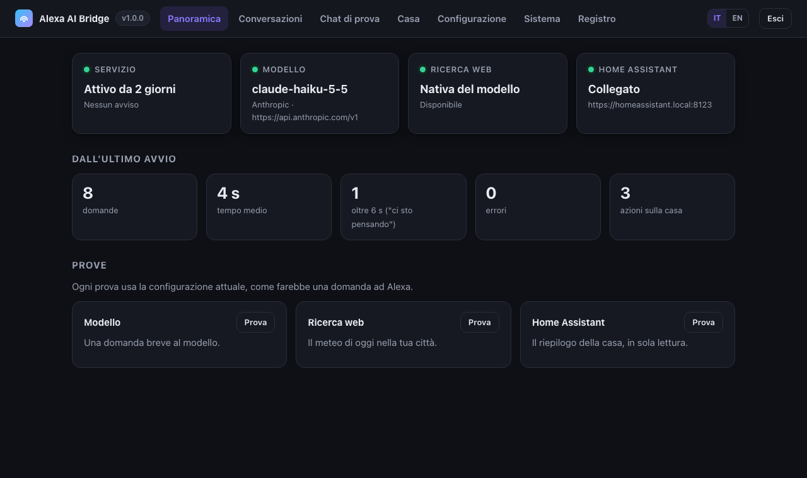
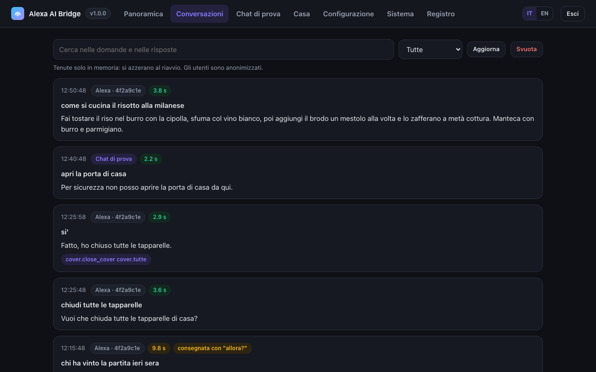
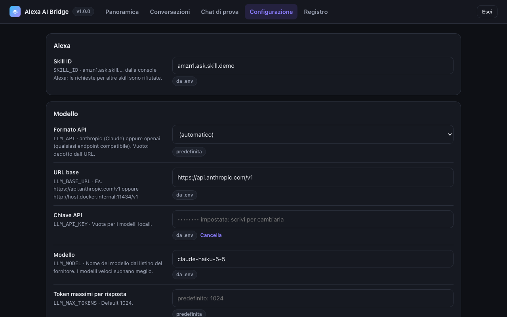

# Admin page

A web page to look after the bridge without a terminal: see whether everything works, read what was asked, try the
assistant by text, and change the settings.

<p align="center"></p>

| Tab | What it does |
|---|---|
| **Panoramica** | Service, model, web search and Home Assistant at a glance; questions, average time, slow answers, errors and home actions since the last start; one-click checks of the model, the web search and Home Assistant. |
| **Conversazioni** | The latest questions and answers with their time, the home actions they ran and any error. Searchable. Users are anonymised. |
| **Chat di prova** | Talk to the assistant by text, with the same model, tools and rules as on the Echo. Home actions are **simulated** by default: every safety check runs, but nothing is sent to Home Assistant. |
| **Configurazione** | Every setting with its explanation. Saving checks the new values, then restarts the service in a few seconds. Keys and tokens are never shown, only whether they are set. |
| **Registro** | The latest log lines, with a filter for warnings and errors. |

<p align="center">
  
  
</p>

## Turn it on

The page is **off** until you set a password of at least 12 characters in `.env`:

```bash
ADMIN_PASSWORD=a-long-password-only-you-know
```

Then `docker compose up -d`. Where you can open it is up to you, and you can combine the options:

| From | Settings in `.env` | Address |
|---|---|---|
| **The server itself** (default) | nothing else | `http://127.0.0.1:8090/admin` on the server, or from your computer through an SSH tunnel: `ssh -L 8090:127.0.0.1:8090 user@server`, then `http://127.0.0.1:8090/admin` |
| **Your home network** | `BRIDGE_BIND=<server LAN IP>`, e.g. `192.168.1.10` | `http://<server-ip>:8090/admin` from any device at home |
| **Anywhere** | `ADMIN_PUBLIC=on` (bundled Caddy) | `https://<PUBLIC_HOST>/admin` |
| **Your own reverse proxy** | `ADMIN_PUBLIC=on` | through the site that already serves `/alexa` |

The service itself refuses `/admin` requests that come through a reverse proxy (they carry `X-Forwarded-*`,
`Forwarded` or `X-Real-IP` headers) unless `ADMIN_PUBLIC=on`, so an existing proxy never publishes the page by
accident. The bundled Caddy also answers 404 on `/admin` unless `ADMIN_PUBLIC` is exactly `on`.

`BRIDGE_BIND` publishes the port on that address. On a home server use its LAN address. **On a VPS do not use
`0.0.0.0`**: the page would be on the internet over plain HTTP, and ports published by Docker bypass firewalls such
as ufw. Use the SSH tunnel or HTTPS instead. `/alexa` is published too, but it only accepts requests signed by Amazon.

A VPN to your home (WireGuard, Tailscale…) gives you the home-network option from anywhere, without publishing the
page on the internet.

## Security

- Off without `ADMIN_PASSWORD`; a password shorter than 12 characters keeps it off (the log says so).
- Passwords are checked one at a time with a one-second pause after each wrong one, so guessing is slow whoever
  tries. After 5 wrong passwords from the same address, that address is refused for 15 minutes; other addresses,
  including yours, are not. Behind the proxy the address is the one the proxy saw, not one the client claims.
- The session cookie is signed with a random key kept in the data volume, never derived from the password. It is
  `HttpOnly`, `SameSite=Strict`, and `Secure` when the page is reached over HTTPS. A session lasts 12 hours from the
  login, however much it is used. *Esci* revokes it on the server, so a copied cookie stops working too. Changing the
  password logs everyone out. Every change needs a CSRF token.
- Strict `Content-Security-Policy`, no external resources, the page cannot be framed.
- Keys and tokens never reach the browser: the page only shows whether they are set, and URLs are shown without
  user names, passwords and query strings. Model answers are never copied into the log.
- The model, Home Assistant and search endpoints must be `http://` or `https://` addresses. Changing the model or
  Home Assistant address requires typing its key or token again in the same save, so a stolen session cannot send
  a stored key to another server.
- Every value is checked before saving (type, length, characters, number ranges, allowed options) and then loaded
  with the startup checks in a separate process: nothing that would stop the service can be saved.

## Conversation history

Kept **in memory only**: it is lost at every restart and never written to disk. `ADMIN_HISTORY` sets how many
questions are kept (default `100`); `ADMIN_HISTORY=0` turns the history off. Amazon user IDs are replaced by a
short anonymous code.

## How saved settings work

- Settings saved from the page are stored in `/data/settings.json`, in the `bridge_data` Docker volume, and take
  precedence over `.env`. *"Torna al valore del .env"* removes the override.
- Before saving, the new values are loaded in a separate process with the same checks as at startup: a wrong value
  (a model block without URL, invalid JSON, an invalid regular expression…) is refused and nothing changes.
- After saving, the service restarts its worker in a few seconds. A slow answer still pending is lost.
- `SKILL_ID` can be changed here; `ADMIN_PASSWORD` cannot (change it in `.env`).
- Running the image without the compose file, Docker creates an anonymous volume for `/data`: settings saved from
  the page are lost when the container is recreated. Mount a named volume (`-v bridge_data:/data`) to keep them.
- After a save the service restarts its worker; a test chat in progress has up to two minutes to finish. The
  conversation history and the log start again empty.

## Settings

| Variable | Default | Meaning |
|---|---|---|
| `ADMIN_PASSWORD` | – | Turns the page on (12 characters or more) |
| `ADMIN_HISTORY` | `100` | Questions kept in the history; `0` turns it off |
| `BRIDGE_BIND` | `127.0.0.1` | Address the service port is published on (the server's LAN IP = home network too) |
| `ADMIN_PUBLIC` | `off` | `on` allows `/admin` through a reverse proxy (the bundled Caddy or your own) |
