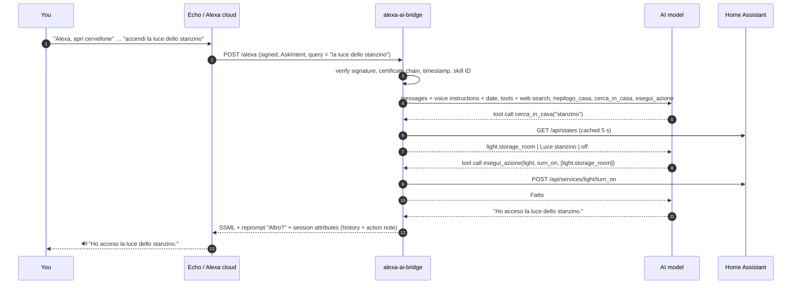
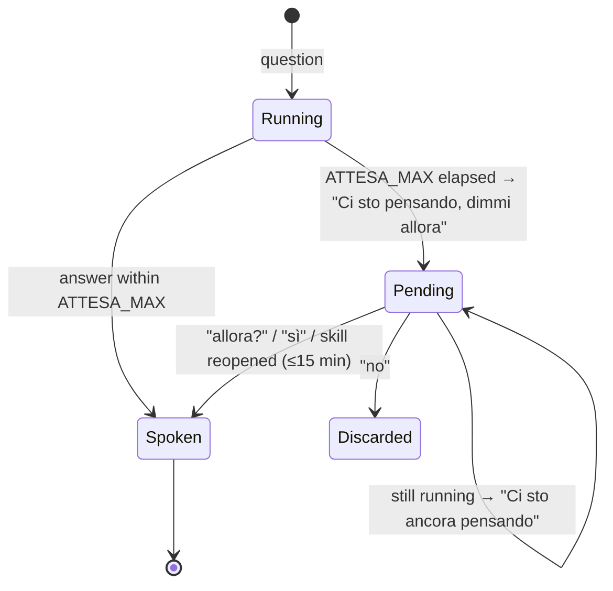
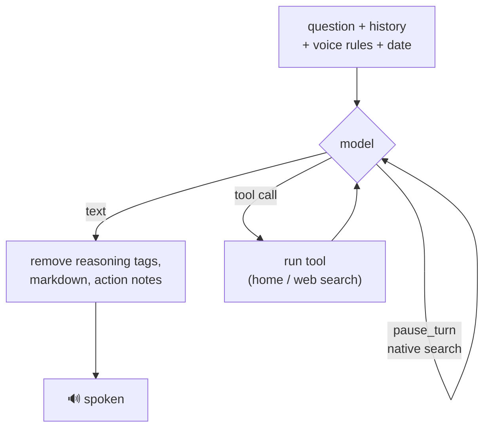

# Architecture

## Components

| Component | Where | Role |
|---|---|---|
| **Alexa custom skill** | Amazon cloud | Speech recognition, intents, slots; calls our endpoint over HTTPS |
| **Reverse proxy** | your host | Public HTTPS with a trusted certificate (Caddy + Let's Encrypt in the example) |
| **`alexa-ai-bridge` service** | Docker container | Verifies Amazon requests, manages the conversation, calls the model, runs tools |
| **The model** | any provider ([list](providers.md)) | Answers, decides when to search the web or use a home tool |
| **Web search** | native (Claude) or SearXNG / Brave / Tavily | Optional: fresh information |
| **Home Assistant** | your home | Optional: state and control through its REST API, with a dedicated user |

The service is four Python files and three dependencies (Flask, gunicorn, cryptography):

- [`src/app.py`](../src/app.py) – HTTP endpoint, request verification, intents, conversation memory,
  slow-answer handling.
- [`src/llm.py`](../src/llm.py) – the two wire formats (Anthropic Messages, OpenAI-compatible Chat Completions),
  the tool loop and graceful degradation.
- [`src/web_search.py`](../src/web_search.py) – native search for Claude, SearXNG / Brave / Tavily for every model.
- [`src/home_tools.py`](../src/home_tools.py) – the three Home Assistant tools and every safety rule.

## A request, end to end

## Conversation state

Alexa keeps **session attributes** between turns of the same session and sends them back with every request.
The service stores the last six messages there (`h`), so the model sees the conversation. Every assistant message
that triggered home actions carries a hidden note, e.g. `[azioni eseguite: light.turn_on light.storage_room]`,
so that on the next turn the model knows what it *did*, not only what it *said*. The note is stripped before
anything is spoken.

## Slow answers: the "allora?" pattern

Alexa waits about 8 seconds for a skill response. Web searches and multi-step home actions can take longer.

Every question runs in a background thread; the HTTP request waits at most `ATTESA_MAX` seconds for it.
Pending answers are kept per Amazon user ID, in memory — which is why the container runs **one** gunicorn
worker (with four threads).

## Talking to the model

Two wire formats cover practically every provider ([full list](providers.md)):

| `LLM_API` | Endpoint | Providers |
|---|---|---|
| `anthropic` | `POST {LLM_BASE_URL}/messages` | Anthropic (Claude), gateways that speak the Messages API |
| `openai` | `POST {LLM_BASE_URL}/chat/completions` | OpenAI, Google Gemini, Mistral, Groq, DeepSeek, xAI, OpenRouter, Together, Ollama, LM Studio, vLLM, LiteLLM… |

The home tools and the client-side web search are defined once (name, description, JSON schema) and sent as
Anthropic `tools` or OpenAI `functions`. The service then runs the same loop for both:

- **Voice instructions in every user turn**: speak Italian, 3–4 sentences, no lists or markdown, never read URLs,
  treat the sentence as a question even if the first word is missing (Alexa drops the carrier phrase).
  They are repeated in each turn because some gateways inject their own system prompt.
- **Reasoning**: Claude's extended thinking is disabled (it can eat the whole token budget and return no text);
  `<think>…</think>` blocks from open reasoning models are removed before speaking; OpenAI-style reasoning
  effort can be set with `LLM_EXTRA_JSON`.
- **Tool loop**: up to 8 rounds of tool calls (or `pause_turn` for Claude's native search). With native search only
  the text after the last search result is spoken (the *"let me check"* preamble is dropped).
- **Graceful degradation**, learned once and remembered:
  - `max_tokens` rejected in favour of `max_completion_tokens` (OpenAI reasoning models) → renamed;
  - native web search rejected (a gateway without server tools) → switched off;
  - tools rejected (a model without function calling) → plain answers, and the instructions stop mentioning tools;
  - an empty answer is retried once.
