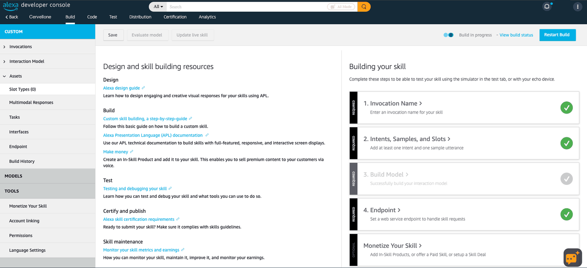
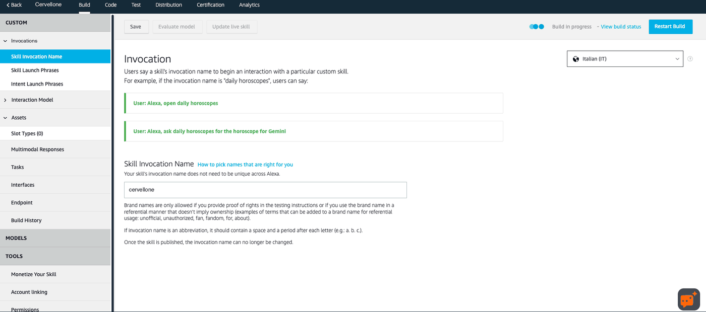
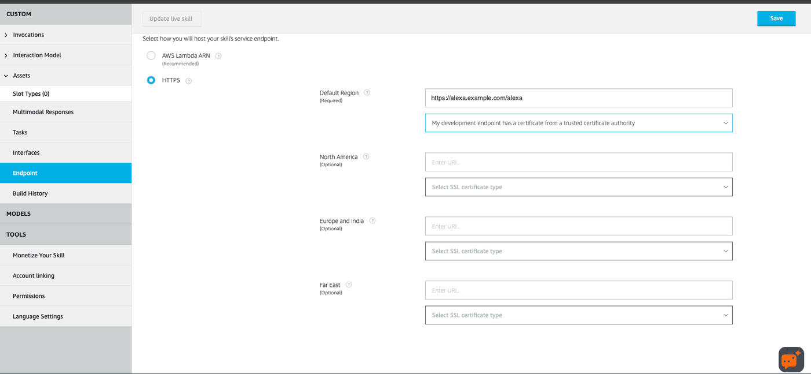
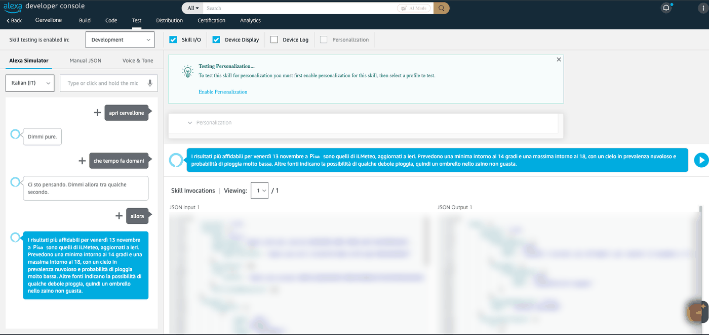

# Setup guide

From zero to *"Alexa, apri cervellone"* in about 45 minutes. At the end you will have:

- a private Alexa skill, visible only on the Echo devices of your Amazon account;
- the bridge running in Docker on your host, behind HTTPS;
- the AI model of your choice answering by voice, with web search and (optionally) Home Assistant.

**Contents:** [Before you start](#before-you-start) ·
[1. Create the skill](#1-create-the-skill) ·
[2. Configure and start the service](#2-configure-and-start-the-service) ·
[3. Expose it over HTTPS](#3-expose-it-over-https) ·
[4. Point the skill to your endpoint](#4-point-the-skill-to-your-endpoint) ·
[5. Test](#5-test) ·
[6. Web search for non-Claude models](#6-web-search-for-non-claude-models-optional) ·
[7. Home Assistant](#7-home-assistant-optional) ·
[8. End-to-end check](#8-end-to-end-check) ·
[9. Admin page](#9-admin-page-optional) ·
[Updating](#updating) ·
[Troubleshooting](#troubleshooting) ·
[Configuration reference](#configuration-reference)

## Before you start

| You need | Notes |
|---|---|
| An **Amazon developer account** | Free, at [developer.amazon.com](https://developer.amazon.com). Sign in with **the same Amazon account as your Echo**: a skill in development only works on that account's devices. |
| A **Linux host with Docker** | A small VPS or a home server. Docker Engine with the Compose plugin: `docker compose version` must work. 256 MB of RAM is enough for the bridge. |
| A **public DNS name** for that host | e.g. `alexa.example.com`, an `A`/`AAAA` record pointing to the host's public IP. On Cloudflare make it **DNS only** (grey cloud), see [Troubleshooting](#troubleshooting). |
| **Ports 80 and 443** reachable from the internet | For HTTPS and the Let's Encrypt certificate. At home: forward both ports on your router to the host. |
| An **AI model** | An API key from any provider, or a local model with Ollama / LM Studio. See [providers.md](providers.md). |
| *Optional:* **Home Assistant** | Reachable from the host. See [step 7](#7-home-assistant-optional). |

The host's clock must be correct (Amazon requests older than 150 seconds are rejected). Most systems sync it
automatically; check with `timedatectl` (`System clock synchronized: yes`).

## 1. Create the skill

In the [Alexa developer console](https://developer.amazon.com/alexa/console/ask) → **Create Skill**:

| Field | Value |
|---|---|
| Name | anything (e.g. *Cervellone*) |
| Primary locale | Italian (IT), or English (US) for an English assistant (you can add the other language later) |
| Type of experience | Other |
| Model | **Custom** |
| Hosting | **Provision your own** |
| Template | Start from scratch |

Then:

1. **Build → Interaction Model → JSON Editor** (left menu): select everything in the editor, paste the content of
   [`skill/interaction-model.it-IT.json`](../skill/interaction-model.it-IT.json) (Italian) or
   [`skill/interaction-model.en-US.json`](../skill/interaction-model.en-US.json) (English), click **Save**.
   Use the *Raw* button on GitHub to copy the file, or download it later from the admin page (**Sistema**).
2. Click **Build skill** (top right) and wait for *Build Successful*, a minute or two. The **Build** tab then shows
   the checklist below: the first three steps green, *Endpoint* still to do (step 4 of this guide).
3. Check **Interaction Model → Intents**: you must see `AskIntent`, `AttesaIntent` and `FraseBreveIntent`. If you
   still see `HelloWorldIntent`, the JSON was not saved: paste it again and **Save** before building.
4. Check **Invocations → Skill Invocation Name**: it shows `cervellone` (or `big brain` for English). This is what
   you say after *"Alexa, apri…"*.
5. Copy the **Skill ID** (`amzn1.ask.skill.…`): in the skill list, *Copy Skill ID* under the skill's name (it is
   also in the browser's address bar, after `/build/custom/`). You need it in the next step.





> 💡 To change the invocation name, edit `invocationName` in the JSON (or in this page) and build again. Choose plain
> words in the skill's language: a brand-like name that works when typed in the simulator may never be recognised by
> voice.

**Both languages in one skill** (optional, any time later): **Language Settings** (left menu, at the bottom) → add
**English (US)** → **Save**. Then switch the language menu at the top of the **Build** page to *English (US)*,
paste [`skill/interaction-model.en-US.json`](../skill/interaction-model.en-US.json) in its JSON Editor, **Save** and
**Build skill**. The endpoint and the Skill ID are shared: nothing else changes. Details in
[alexa-skill.md](alexa-skill.md#one-skill-both-languages).

## 2. Configure and start the service

On the host:

```bash
git clone https://github.com/LucaTomei/alexa-ai-bridge.git && cd alexa-ai-bridge
cp .env.example .env && chmod 600 .env
nano .env        # or any editor
```

In `.env`, set at least:

- `SKILL_ID`: the ID from step 1;
- `LANGUAGE`: `auto` (the default) answers in the language of each request, so Italian and English both work;
- **one model block**: `LLM_API`, `LLM_BASE_URL`, `LLM_API_KEY`, `LLM_MODEL`. Claude is active by default; to use
  another provider, comment out the Claude lines and uncomment another block ([all presets](providers.md));
- `PUBLIC_HOST`: your DNS name, if you will use the bundled Caddy in step 3;
- `HOME_CITY` (optional): your city, for weather and local searches.

Every other variable has a working default and is described in the
[configuration reference](#configuration-reference).

Start it and check it. Compose downloads the prebuilt image for your CPU (amd64 or arm64, e.g. a Raspberry Pi)
from the [releases](https://github.com/LucaTomei/alexa-ai-bridge/releases); add `--build` to build it from source
instead.

```bash
docker compose up -d
docker compose ps                         # alexa-ai-bridge: Up ... (healthy) after a minute
curl -s http://127.0.0.1:8090/health      # {"ok":true}
```

Check that the model answers **before** involving Alexa:

```bash
docker exec alexa-ai-bridge python -c "import app; print(app.ask_llm([{'role':'user','content':'ciao, chi sei?'}]))"
```

You should read a short Italian answer. An error such as `HTTP 401` means a wrong API key, `HTTP 404` a wrong
model name or base URL. If the container keeps restarting, `docker logs alexa-ai-bridge` shows which variable is
missing.

## 3. Expose it over HTTPS

Alexa only calls HTTPS endpoints with a certificate from a trusted CA. The service listens on `127.0.0.1:8090`
only; a reverse proxy publishes it. Choose **one** option.

### Option A: the bundled Caddy (simplest)

With `PUBLIC_HOST` set in `.env`, the DNS record in place and ports 80/443 free on the host:

```bash
docker compose --profile caddy up -d
docker logs -f alexa-ai-bridge-caddy      # wait for "certificate obtained successfully", then Ctrl+C
```

> 💡 To avoid typing the profile every time, add `COMPOSE_PROFILES=caddy` to `.env` (or `caddy,searxng`
> with [step 6](#6-web-search-for-non-claude-models-optional)): from then on, a plain `docker compose up -d` starts
> everything.

### Option B: your own reverse proxy

If ports 80/443 are already used by a reverse proxy (Caddy, nginx, Traefik…), add a site that forwards to
`http://127.0.0.1:8090`. With Caddy on the host:

```caddyfile
alexa.example.com {
	reverse_proxy 127.0.0.1:8090
}
```

If your proxy runs in Docker, attach it to the same network as the bridge and use `alexa-ai-bridge:8090` as the
upstream. Whatever the proxy, it must pass the request **body and headers unchanged**: Amazon signs the raw body
and sends the signature in the `Signature-256` and `SignatureCertChainUrl` headers.

### Option C: Cloudflare Tunnel (no open ports at home)

If you already run `cloudflared`, the bridge can be published through it: no port forwarding, works behind CGNAT.

1. In `.env` set `BRIDGE_BIND` to the LAN address of the machine running the bridge (and `BRIDGE_PORT` if 8090 is
   taken), so that `cloudflared` can reach it: `docker compose up -d`.
2. Cloudflare → **Zero Trust → Networks → Tunnels** → your tunnel → **Public Hostname / Routes** → add
   `alexa.example.com` → type `HTTP` → `<lan-ip>:<port>` of the bridge.
3. On the domain, **Security → Settings** (*Bot traffic*): **Bot Fight Mode off**. It blocks Alexa's requests,
   which come from AWS data centres, and it cannot be skipped per hostname on the free plan. Check also that no
   custom rule blocks other countries (Alexa calls from the US or Ireland) or challenges the skill's hostname.
4. Optional, defence in depth: **Security → WAF → Custom rules** → block
   `(http.host eq "alexa.example.com" and starts_with(http.request.uri.path, "/admin"))`. The bridge already refuses
   `/admin` through any proxy unless `ADMIN_PUBLIC=on`.
5. In step 4 below choose the **wildcard** certificate option: Cloudflare serves a certificate for
   `*.example.com`, not one issued for the skill's hostname.

If the simulator answers *"Non posso raggiungere la Skill richiesta"* and nothing reaches the bridge's log, look at
**Security → Events** filtered on the skill's host: a blocked request shows which feature stopped it. No event at all
means Alexa never sent the request, usually because of the certificate type in step 4.

### Check from outside

From another network (your phone on mobile data, or any other machine):

```bash
curl -s https://alexa.example.com/health                                                   # {"ok":true}
curl -s -o /dev/null -w '%{http_code}\n' -X POST -d '{}' https://alexa.example.com/alexa   # 400
```

`400` is the expected answer: the request is not signed by Amazon, so the service refuses it.

## 4. Point the skill to your endpoint

In the developer console, **Build → Endpoint** (left menu):



1. Service endpoint type: **HTTPS** (not *AWS Lambda ARN*).
2. Default Region: `https://alexa.example.com/alexa` (your name, with `/alexa` at the end). Leave North America,
   Europe and Far East empty: the default region serves every country.
3. SSL certificate type:
   - *"My development endpoint has a certificate from a trusted certificate authority"* when the certificate is
     issued for that exact name (Caddy, options A and B);
   - *"My development endpoint is a sub-domain of a domain that has a wildcard certificate from a certificate
     authority"* when it is a wildcard certificate, as with **Cloudflare** (option C or any proxied record).

   The wrong choice fails silently: Alexa does not send the request at all, so nothing shows up anywhere.
   To see which one you have: `echo | openssl s_client -connect alexa.example.com:443 -servername alexa.example.com 2>/dev/null | openssl x509 -noout -ext subjectAltName`
   (a `*.` name means wildcard).
4. **Save** (top right). The *Endpoint* step of the Build checklist turns green.

## 5. Test

In the console, **Test** tab → set *Skill testing is enabled in* to **Development**, choose the language next to
the text box (*Italian (IT)* or *English (US)*) and tick **Skill I/O** to see what Alexa sends and receives. Type or
say:

```
apri cervellone
perché il cielo è blu
e di sera perché diventa rosso
che tempo fa domani
basta
```

A working conversation looks like this, including a slow answer collected with *"allora"*:



Then on the Echo: *"Alexa, apri cervellone"* (English: *"Alexa, open big brain"*). The skill is already available on every Echo of your account: no
publishing or certification is needed.

Follow the service while you test:

```bash
docker logs -f alexa-ai-bridge 2>&1 | grep -E "POST|domanda risposta|risposta lenta|web search|azione HA|rifiutata|rejected|modello"
```

How to talk to it:

- start sentences with a normal opening word (*che, come, perché, dimmi, accendi…*): that is how Alexa captures
  free text, see [alexa-skill.md](alexa-skill.md#carrier-phrases);
- if an answer takes longer, Alexa says *"Ci sto pensando"*: say *"allora?"* a few seconds later;
- *"basta"*, *"stop"* or *"grazie"* close the skill.

## 6. Web search for non-Claude models (optional)

Claude searches the web natively, nothing to do. Every other model needs a search backend: the free option is the
bundled SearXNG.

In `.env` set `SEARXNG_URL=http://searxng:8080` and `SEARXNG_SECRET` to a random value (`openssl rand -hex 32`
prints one); both lines already exist. Then:

```bash
docker compose --profile searxng up -d      # add --profile caddy if you use option A
docker exec alexa-ai-bridge python -c "import web_search as w; print(w.cerca('meteo Roma domani', 'searxng'))"
```

Brave and Tavily need only their API key in `.env`. Details in [providers.md](providers.md#web-search).

## 7. Home Assistant (optional)

Full guide in [home-assistant.md](home-assistant.md). In short:

1. Create a dedicated **non-admin** user in Home Assistant and a **long-lived access token** for it.
2. Set `HA_URL` and `HA_TOKEN` in `.env`. List groups that act on several rooms in `HA_GRUPPI`.
3. `docker compose up -d` and ask *"com'è la casa?"*.

Locks, alarms, scripts and automations can never be controlled, whatever the model asks; neither can entities
whose ID or name says door, gate or alarm (Italian or English words). Add your own with `HA_VIETATO`.

## 8. End-to-end check

[`scripts/e2e.py`](../scripts/e2e.py) runs a scripted conversation inside the running container, against your real
model and your real home: a question, a web search, the home summary, a light on and off, a multi-room action that
must ask first and must not run after *"no"*, a door that must not open.

```bash
E2E_LIGHT=light.storage_room E2E_LIGHT_NAME="la luce dello stanzino" E2E_LOCK=lock.front_door \
PUBLIC_URL=https://alexa.example.com python3 scripts/e2e.py
```

The only real action is on the light you choose, and the script puts it back as it was. Without Home Assistant the
home checks are skipped. It ends with `RESULT: ALL OK` (exit code 0) when every check passed.

## 9. Admin page (optional)

Set `ADMIN_PASSWORD` in `.env` (12 characters or more) and `docker compose up -d`: the page is at
`http://127.0.0.1:8090/admin` on the server. From there you can check every part, read the conversations, try the
assistant by text, choose which devices it may control and change the settings without touching `.env`. To open it
from your home network or from anywhere, see [admin.md](admin.md#turn-it-on).

## Updating

Every release publishes a new image. `BRIDGE_VERSION` in `.env` chooses which one you run: `1` (the default in
`.env.example`) follows every `1.x` release, which never needs changes to your configuration; an exact version such as
`1.0.0` stays put until you change it; `latest` follows every release.

```bash
cd alexa-ai-bridge
git pull                                  # docs, compose file and .env.example
docker compose pull && docker compose up -d
```

`.env` is never touched by an update. After a new major version, compare it with `.env.example`.

**Automatic updates** (optional): a nightly cron job on the host keeps the service on the newest image of your
`BRIDGE_VERSION`. Run `crontab -e` and add:

```
30 4 * * * cd /path/to/alexa-ai-bridge && docker compose pull -q && docker compose up -d && docker image prune -f
```

`up -d` only recreates the container when the image changed, so most nights nothing happens. Use your own path,
and the same profiles you start the service with (or set `COMPOSE_PROFILES` in `.env`).

Running a build from source (`--build`) instead? Update with `git pull && docker compose up -d --build`.

## Troubleshooting

| Symptom | Cause and fix |
|---|---|
| The container restarts in a loop | A required variable is missing: `docker logs alexa-ai-bridge` names it (`SKILL_ID`, `LLM_BASE_URL`, `LLM_MODEL`). |
| Simulator: *"Non posso raggiungere la Skill richiesta"* (*"There was a problem with the requested skill's response"*), **JSON Input** filled, **JSON Output** only `_DEFAULT_RESPONSE` ([screenshot](images/alexa-console-unreachable.png)) | Alexa found the skill but your endpoint did not answer. Run the [outside checks](#check-from-outside); check the endpoint URL ends with `/alexa` and the certificate type of step 4 (**wildcard** behind Cloudflare). |
| Same, and the service log shows nothing | The request is blocked before your host: Cloudflare proxy / Bot Fight Mode (use a **DNS-only** record), a firewall, or a router without port forwarding. |
| Log: `richiesta rifiutata: skill diversa` | `SKILL_ID` in `.env` is not the ID of this skill. Fix it and `docker compose up -d`. |
| Log: `richiesta rifiutata: richiesta troppo vecchia` | The host's clock is wrong: enable time sync (`sudo timedatectl set-ntp true`). |
| Log: `richiesta rifiutata: firma non valida` | Something between Amazon and the service changes the body (a proxy rewriting or compressing requests). Forward it unchanged. |
| Every sentence gets *"Non ho capito"* | The interaction model was not saved or built (step 1, point 3), or the sentence does not start with an opening word. |
| The Echo says *"Purtroppo non so come aiutarti"* | The invocation name was not recognised by voice, or the Echo is on a different Amazon account than the developer console. |
| Alexa says *"Non sono riuscito a rispondere"* | The model call failed: `docker logs alexa-ai-bridge 2>&1 \| grep modello` shows the provider's error (key, model name, credit). |
| Log: `tools rejected by the endpoint or model` | The model has no function calling: answers work, home control and client-side search don't. Pick a tool-capable model. |
| Answers often end in *"Ci sto pensando"* | The model is slow for voice: choose a faster model (*haiku / mini / flash*) or, for reasoning models, `LLM_EXTRA_JSON={"reasoning_effort": "low"}`. |
| Home Assistant: `Errore nel contattare Home Assistant`, HTTP 403 | A WAF blocks the request: see [home-assistant.md](home-assistant.md#dedicated-home-assistant-user). |
| Caddy: no certificate | DNS does not point to the host yet, or ports 80/443 are not reachable from the internet. |
| The date or time is off by one hour | `HOME_TIMEZONE` is not a valid name (e.g. `Europe/Rome`); the log says so at startup. |

More background in [lessons-learned.md](lessons-learned.md).

## Configuration reference

All variables go in `.env`. Only `SKILL_ID`, `LLM_BASE_URL` and `LLM_MODEL` are required.

| Variable | Default | Meaning |
|---|---|---|
| `SKILL_ID` | – | Only requests for this skill are accepted |
| `LANGUAGE` | `auto` | Language of the assistant: `auto` (the language the Echo speaks), `it` or `en` |
| `PUBLIC_HOST` | `alexa.example.com` | DNS name used by the bundled Caddy (`--profile caddy`) |
| `BRIDGE_VERSION` | `latest` (`.env.example` sets `1`) | Image version to run: `latest`, a major (`1`) or an exact version (`1.0.0`) |
| `COMPOSE_PROFILES` | – | Optional containers started by `docker compose up`, e.g. `caddy,searxng` |
| `LLM_API` | `anthropic` if the URL is api.anthropic.com, else `openai` | Wire format: `anthropic` or `openai` (OpenAI-compatible) |
| `LLM_BASE_URL`, `LLM_API_KEY`, `LLM_MODEL` | – | Endpoint, key (empty for local models) and model ([examples](providers.md)) |
| `LLM_MAX_TOKENS` | `1024` | Max tokens per answer |
| `LLM_EXTRA_JSON` | `{}` | Extra fields for every request, e.g. `{"reasoning_effort": "low"}` |
| `ATTESA_MAX` | `6.0` | Seconds before "Ci sto pensando"; keep ≤ 7 (Alexa waits about 8 in total) |
| `LLM_TIMEOUT_LUNGO` | `120` | Max seconds for a background answer |
| `WEB_SEARCH` | `auto` | `auto`, `native` (Claude only), `searxng`, `brave`, `tavily`, `off` |
| `SEARXNG_URL`, `BRAVE_API_KEY`, `TAVILY_API_KEY` | – | Client-side search backends |
| `SEARXNG_SECRET` | – | Secret of the bundled SearXNG container (`openssl rand -hex 32`) |
| `BRAVE_URL`, `TAVILY_URL` | the official APIs | Alternative endpoints for Brave / Tavily |
| `WEB_RESULTS`, `WEB_LANGUAGE`, `WEB_MAX` | `5`, the conversation's language, `3` | Results per search, search language (`it`, `en`…), native searches per question |
| `HOME_CITY`, `HOME_REGION`, `HOME_COUNTRY`, `HOME_TIMEZONE` | –, –, –, `Europe/Rome` | Local searches and "today" |
| `HA_URL`, `HA_TOKEN`, `HA_TOOLS` | –, –, `1` | Home Assistant tools (off without a token, or with `HA_TOOLS=0`) |
| `HTTP_USER_AGENT` (`HA_UA`) | `alexa-ai-bridge/1.0` | User agent for outgoing calls (`HA_UA` overrides it for Home Assistant) |
| `HA_GRUPPI` | – | Comma-separated entities acting on several rooms (always confirmed) |
| `HA_MAX_SENZA_CONFERMA` | `3` | More entities than this in one answer → confirmation |
| `HA_SUMMARY_EXTRA` | – | `entity_id=Label,…` extra lines in the home summary |
| `HA_TEMP_PATTERN` | – | Regex of temperature sensors for the summary |
| `HA_VIETATO` | – | Regex (on entity ID and name) of extra entities that can never be controlled, **added** to the built-in list |
| `SYSTEM_PROMPT`, `ISTRUZIONI_TURNO` | built-in voice rules, in the language of the request | Override the instructions (then in one language only) |
| `ADMIN_PASSWORD` | – | Turns the [admin page](admin.md) on (12 characters or more) |
| `ADMIN_HISTORY` | `100` | Questions kept in the admin page history; `0` turns it off |
| `BRIDGE_PORT` | `8090` | Port on the host, if 8090 is already in use (the URLs in these docs then use it instead of 8090) |
| `BRIDGE_BIND` | `127.0.0.1` | Address of the published port; the server's LAN IP opens it to your home network |
| `ADMIN_PUBLIC` | `off` | `on` allows `/admin` through a reverse proxy (the bundled Caddy or your own) |
